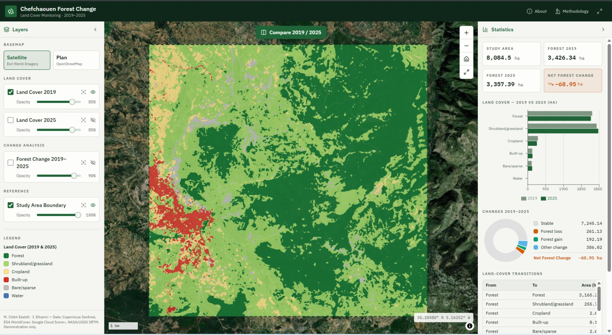

# WebGIS Chefchaouen — Land Cover & Forest Change Monitoring (2019–2025)

Application WebGIS consacrée au suivi cartographique de l’occupation du sol et des changements forestiers dans la zone de Chefchaouen entre 2019 et 2025. La démonstration publique présente les rasters, les statistiques et les outils de comparaison à partir de ressources statiques préparées pour le Web.

## Démonstration publique

**[Ouvrir l’application WebGIS Chefchaouen](https://chefchaouen-webgis-static-test.onrender.com)**



## Fonctionnalités

- visualisation des occupations du sol 2019 et 2025 ;
- carte des changements forestiers 2019–2025 ;
- comparaison par balayage (**Swipe**) ;
- comparaison par transparence (**Opacity**) ;
- légendes des classes et des changements ;
- consultation des informations d’un pixel par clic ;
- statistiques, indicateurs, graphiques et transitions ;
- pages **About** et **Methodology** ;
- interface responsive pour desktop et mobile.

## Principaux résultats affichés

Les valeurs ci-dessous sont celles fournies par les données du projet et affichées par l’application. Elles ne constituent pas une nouvelle validation scientifique indépendante réalisée par cette application.

| Indicateur | Valeur |
| --- | ---: |
| Superficie forestière 2019 | **3 426,34 ha** |
| Superficie forestière 2025 | **3 357,39 ha** |
| Variation nette de la superficie forestière | **−68,95 ha** |

La superficie de la zone d’étude affichée est de **8 084,5 ha**. Les autres superficies, transitions et indicateurs de précision sont conservés dans les fichiers statistiques livrés avec le projet.

## Technologies

- React et TypeScript/JavaScript ;
- MapLibre GL pour la cartographie interactive ;
- Recharts pour les graphiques ;
- ressources statiques PNG et BIN pour les rasters et la lecture des classes au clic ;
- JSON et GeoJSON pour les statistiques, les légendes et la zone d’étude ;
- Vite, TanStack Start et Nitro pour le build frontend ;
- Render Static Site pour la publication de la version statique.

## Version statique et architecture dynamique

La démonstration publique utilise le mode statique activé avec `VITE_STATIC_DEFAULT=true`. Les rasters, les valeurs pixel, les statistiques, les transitions, la légende et la zone d’étude sont alors chargés depuis `frontend/public/static-data/`, sans dépendre de FastAPI, PostgreSQL/PostGIS ou Docker pendant l’utilisation du site.

Le projet conserve également une architecture dynamique : en mode normal, le frontend peut utiliser l’API FastAPI et les données PostGIS. Les endpoints API, le backend Docker et la base PostgreSQL ne sont pas supprimés ; ils restent disponibles pour le développement, les tests et les usages dynamiques.

## Données et méthode

La [notice des données et de la méthode](data/README.md) décrit les sources, les codes de classes, la production des cartes, les superficies fournies et les limites d’interprétation. Les ressources statiques utilisées par la démonstration sont préparées à partir des données officielles du projet et regroupées dans [`frontend/public/static-data/`](frontend/public/static-data/).

Les principaux fichiers statiques sont :

- [`manifest.json`](frontend/public/static-data/manifest.json) : métadonnées des trois rasters ;
- [`study_area.geojson`](frontend/public/static-data/study_area.geojson) : zone d’étude ;
- [`statistics/summary.json`](frontend/public/static-data/statistics/summary.json) : indicateurs et superficies ;
- [`statistics/transitions.json`](frontend/public/static-data/statistics/transitions.json) : transitions 2019–2025 ;
- [`statistics/legend.json`](frontend/public/static-data/statistics/legend.json) : classes et couleurs ;
- [`rasters/`](frontend/public/static-data/rasters/) : images PNG et classes BIN.

## Lancement local de la version statique

Depuis la racine du projet :

```powershell
cd frontend
npm install
$env:VITE_STATIC_DEFAULT="true"
npm run dev -- --host 127.0.0.1 --port 8081 --strictPort
```

Ouvrir ensuite <http://127.0.0.1:8081/>. Le mode statique complet est activé automatiquement par `VITE_STATIC_DEFAULT=true`.

Pour générer et prévisualiser le build de production :

```powershell
cd frontend
$env:VITE_STATIC_DEFAULT="true"
npm run build
npm run preview -- --host 127.0.0.1
```

Les paramètres suivants restent disponibles pour les tests :

- `?staticTest=all` : force le mode statique complet ;
- `?staticTest=2019` : teste le raster 2019 ;
- `?staticTest=api` : force le mode API uniquement dans les environnements de développement prévus pour cela.

## Lancement local de l’architecture dynamique

La version dynamique nécessite Docker, FastAPI et PostgreSQL/PostGIS :

```powershell
docker compose up -d --build
docker compose ps
```

PostGIS est exposé sur `localhost:5434` et l’API sur <http://localhost:8001/> (`/docs` pour Swagger). Dans un second terminal :

```powershell
cd frontend
npm install
npm run dev -- --host 127.0.0.1 --port 8081 --strictPort
```

Sans `VITE_STATIC_DEFAULT=true`, le frontend cible par défaut `http://localhost:8001`. Pour une autre adresse API, définir `VITE_API_URL` dans `frontend/.env` à partir de [`frontend/.env.example`](frontend/.env.example). Ne jamais publier le fichier `.env`.

## Contrôles et documentation

Depuis la racine du projet :

```powershell
python -m unittest discover -s backend/tests -v
cd frontend
npx tsc --noEmit
npm run lint
npm run build
```

La [documentation par phases](docs/README.md) détaille l’audit, l’intégration frontend et la préparation de la publication. Le [guide de publication](docs/07-publication-en-ligne.md) décrit le déploiement Render. Les fonds Esri World Imagery et OpenStreetMap nécessitent un accès Internet.

## Crédits

- **Mohamed** — analyse satellitaire, traitement et fourniture des données scientifiques ;
- **Imane Elhamri** — développement WebGIS, intégration cartographique, interfaces, version statique et déploiement.
